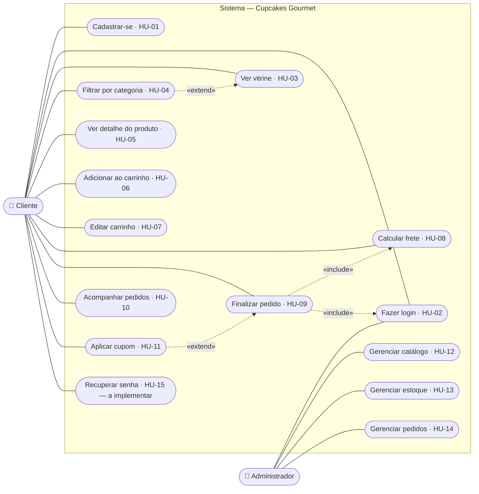
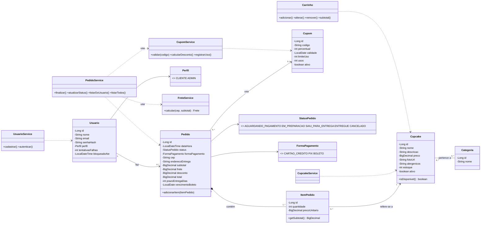
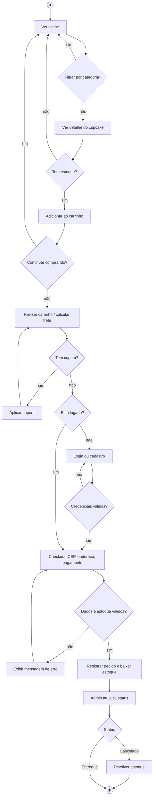

# Diagramas UML — Cupcakes Gourmet

Diagramas em Mermaid: o GitHub renderiza automaticamente ao abrir este arquivo.
Foram conferidos contra o código (pacote `br.com.cupcakes`).

## 1. Casos de uso



Observação: o administrador faz login pelo mesmo caso de uso (HU-02); o perfil `ADMIN` libera as rotas `/admin/**`.

## 2. Classes (domínio e camadas)



## 3. Sequência — Finalizar pedido (HU-09)

```mermaid
sequenceDiagram
    actor C as Cliente
    participant PC as PedidoController
    participant PS as PedidoService
    participant FS as FreteService
    participant DB as MySQL (repositories)

    C->>PC: POST /checkout (cep, endereço, forma de pagamento)
    PC->>PS: finalizar(usuarioId, itens, cep, endereço, forma)
    PS->>PS: valida carrinho, endereço e forma de pagamento
    PS->>DB: busca usuário
    loop para cada item do carrinho
        PS->>DB: relê cupcake (estoque atual)
        alt estoque insuficiente ou inativo
            PS-->>PC: NegocioException("Estoque insuficiente...")
            PC-->>C: volta ao checkout com mensagem de erro (rollback)
        else estoque ok
            PS->>DB: baixa estoque (HU-13 RN#1)
        end
    end
    opt cupom aplicado (HU-11)
        PS->>DB: valida cupom (validade, limite de uso)
        PS->>PS: desconto = subtotal × percentual
        PS->>DB: registra mais um uso do cupom
    end
    PS->>FS: calcular(cep, subtotal − desconto)
    alt CEP não atendido
        FS-->>PS: NegocioException("Entrega não disponível...")
        PS-->>PC: erro (transação desfeita)
        PC-->>C: mensagem de erro
    else CEP atendido
        FS-->>PS: frete (valor, prazo)
        PS->>PS: total = subtotal + frete; boleto → vencimento +2 dias úteis
        PS->>DB: salva pedido (status AGUARDANDO_PAGAMENTO)
        PS-->>PC: pedido
        PC-->>C: redireciona para "Meus pedidos" com confirmação
    end
```

## 4. Atividades — Do acesso ao pedido concluído


