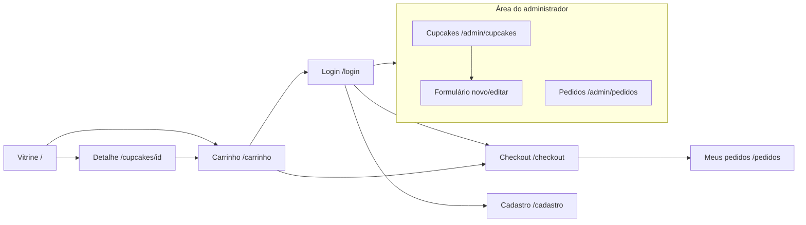

# Interface (IHC) — revisão

## Mapa de telas

Rotas protegidas por login: `/checkout`, `/pedidos` e `/admin/**` (esta, só para ADMIN).

## Protótipo = telas reais
As telas abaixo, em `prints/`, substituem o protótipo do PIT I. Todas estão também no manual de uso (`situacao-2-codigo/cupcakes-app/docs/manual-de-uso.md`).

| Arquivo | Tela |
|---|---|
| `01-vitrine.png` | Vitrine |
| `02-vitrine-filtro-chocolate.png` | Vitrine filtrada por categoria |
| `03-detalhe-alergenicos.png` | Detalhe com alerta de alergênicos |
| `04-cadastro.png` / `05-cadastro-erro-email-repetido.png` | Cadastro e erro de e-mail repetido |
| `06-login-erro-credenciais.png` | Login com senha errada |
| `07-vitrine-item-adicionado.png` | Feedback "Item adicionado ao carrinho" |
| `08-carrinho-cupom-erro.png` / `09-carrinho-cupom-aplicado.png` | Cupom inválido e cupom aplicado |
| `10-carrinho-frete-calculado.png` / `11-carrinho-cep-fora-da-area.png` | Frete calculado e CEP não atendido |
| `12-checkout.png` | Finalizar pedido |
| `13-meus-pedidos.png` | Meus pedidos |
| `14-admin-produtos-estoque.png` / `15-admin-editar-cupcake.png` | Admin: catálogo e estoque |
| `16-admin-pedidos.png` | Admin: pedidos e status |
| `17-carrinho-vazio.png` | Carrinho vazio |
| `18-vitrine-celular.png` | Vitrine no celular (responsividade) |

## Mensagens de erro e feedback (conferidas no código)

| Situação | Mensagem |
|---|---|
| Campos vazios no cadastro | Preencha todos os campos obrigatórios |
| E-mail inválido | E-mail inválido |
| Senha curta | A senha deve ter no mínimo 8 caracteres |
| E-mail repetido | E-mail já cadastrado |
| Cupom vencido, esgotado ou inexistente | Cupom inválido ou expirado |
| Login errado | Credenciais inválidas |
| 5 erros de login | Acesso bloqueado por excesso de tentativas. Tente novamente em 15 minutos. |
| CEP fora da área | Entrega não disponível para esta região |
| Carrinho vazio no checkout | Seu carrinho está vazio |
| Endereço vazio | Informe o endereço de entrega |
| Sem forma de pagamento | Selecione a forma de pagamento |
| Estoque esgotado | Estoque insuficiente para: (nome do produto) |
| Cancelado reaberto | Pedidos cancelados não podem ter o status revertido |

## Avaliação contra os princípios do material teórico

| Princípio | Como o sistema atende | Melhoria sugerida |
|---|---|---|
| Clara | Mensagens objetivas em português | Destacar o campo com erro no formulário |
| Consistente | Cabeçalho e alertas em `fragments.html` reutilizados | — |
| Simples | Fluxo vitrine → carrinho → checkout | — |
| Controlada pelo usuário | Usuário altera e remove itens do carrinho | — |
| Recuperável | Carrinho editável antes de finalizar | Pedir confirmação ao remover cupcake (admin) e ao cancelar pedido |
| Dá resposta (feedback) | Alertas de erro e sucesso | Mostrar confirmação com o número do pedido |
| Agradável | CSS próprio | Conferir contraste e tamanho de fonte no celular |

Responsividade (HU-03 RNF#2): conferida na largura de celular (390 px), ver `18-vitrine-celular.png`.
