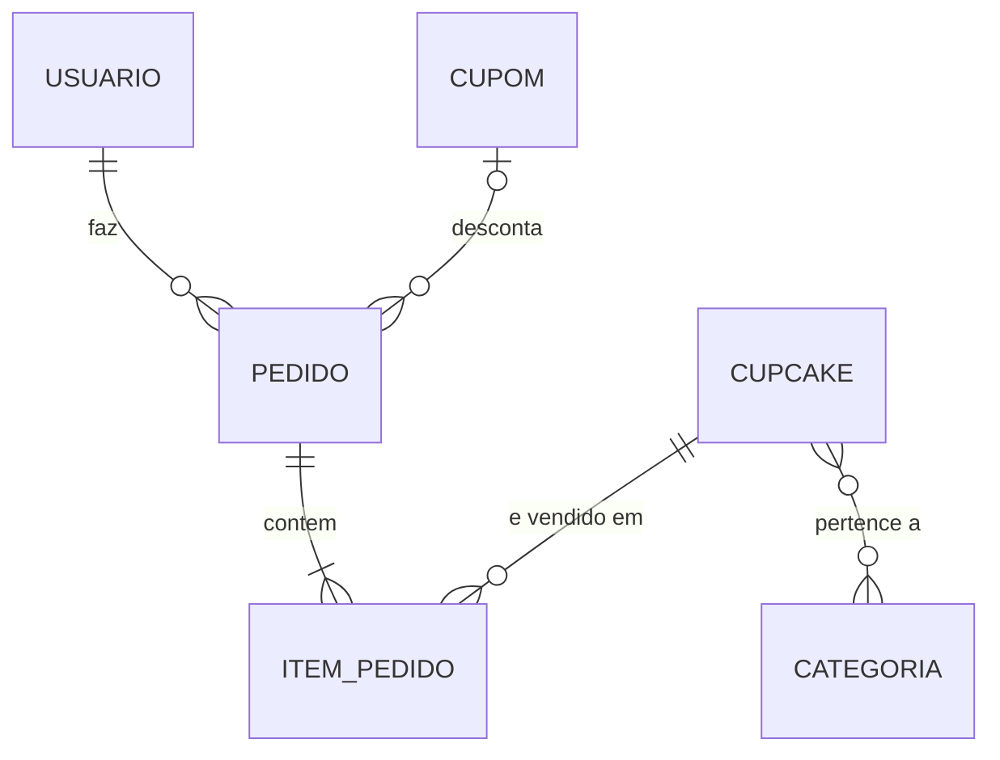

# Projeto de dados

Gerado a partir do diagrama de classes de persistência (ver `02-diagramas-uml.md`, seção 2).

## 1. Modelo conceitual
Entidades e relacionamentos (sem tipos de dados):

| Relacionamento | Cardinalidade | Regra |
|---|---|---|
| Usuario – Pedido | 1:N | Um cliente faz vários pedidos |
| Pedido – ItemPedido | 1:N | Todo pedido tem pelo menos um item |
| Cupcake – ItemPedido | 1:N | Um cupcake aparece em vários itens |
| Cupom – Pedido | 1:N (opcional) | HU-11: um pedido usa no máximo um cupom |
| Cupcake – Categoria | N:N | HU-04 RN#1; vira a tabela associativa `cupcake_categoria` |

## 2. Modelo lógico normalizado
Esquema relacional (PK sublinhada em negrito, FK com seta):

- **usuario**(**id**, nome, email *único*, senha_hash, perfil, tentativas_falhas, bloqueado_ate)
- **categoria**(**id**, nome *único*)
- **cupcake**(**id**, nome, descricao, preco, foto_url, alergenicos, estoque, ativo)
- **cupcake_categoria**(**cupcake_id** → cupcake, **categoria_id** → categoria)
- **cupom**(**id**, codigo *único*, percentual, validade, limite_uso, usos, ativo)
- **pedido**(**id**, usuario_id → usuario, cupom_id → cupom *opcional*, data_hora, status, forma_pagamento, cep, endereco_entrega, subtotal, desconto, frete, total, prazo_entrega_dias, vencimento_boleto)
- **item_pedido**(**id**, pedido_id → pedido, cupcake_id → cupcake, quantidade, preco_unitario)

Normalização (1FN, 2FN, 3FN) justificada em `modelo-fisico/dicionario-de-dados.md`.

## 3. Modelo físico
- Script: `modelo-fisico/01_schema.sql` (+ `02_cupom.sql` para atualizar um banco antigo) (MySQL 8 / MariaDB 10.4+, gerenciado pelo HeidiSQL).
- Dicionário de dados completo (tipos, nulidade, regras): `modelo-fisico/dicionario-de-dados.md`.
- Restrições no banco: e-mail e código de cupom únicos, percentual do cupom entre 1 e 100, `preco > 0`, `estoque >= 0`, `quantidade` entre 1 e 50, chaves estrangeiras em todas as relações.
- Observação: a aplicação usa `spring.jpa.hibernate.ddl-auto=update`, então o Hibernate também ajusta tabelas. O script SQL é a referência oficial do modelo físico.
