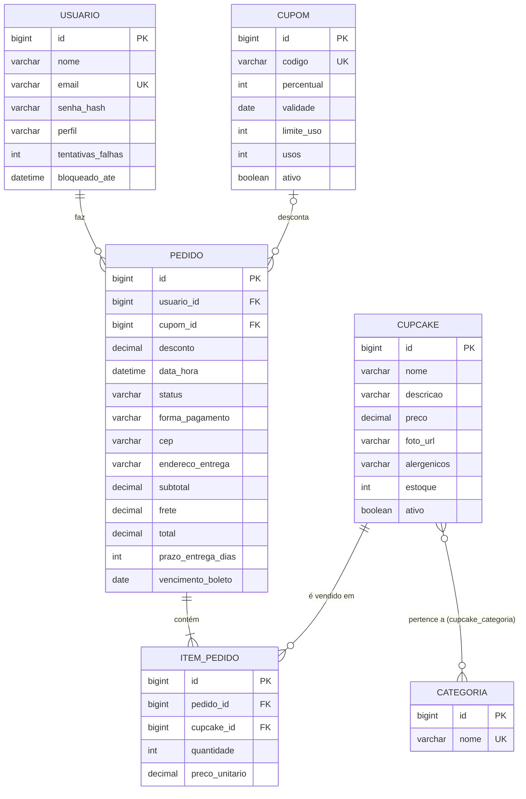

# Modelo de dados — Cupcakes Gourmet

## Diagrama entidade-relacionamento

## Dicionário de dados

### usuario
| Coluna | Tipo | Nulo | Descrição | Regra |
|---|---|---|---|---|
| id | BIGINT AI | Não | Chave primária | |
| nome | VARCHAR(100) | Não | Nome completo | |
| email | VARCHAR(150) | Não | E-mail de login | Único (HU-01 RN#1) |
| senha_hash | VARCHAR(100) | Não | Senha criptografada com BCrypt | Mínimo 8 caracteres antes do hash (HU-01 RN#2) |
| perfil | VARCHAR(20) | Não | `CLIENTE` ou `ADMIN` | |
| tentativas_falhas | INT | Não | Erros de senha consecutivos | Zera no login correto |
| bloqueado_ate | DATETIME | Sim | Fim do bloqueio de acesso | 5 erros → 15 min (HU-02 RN#1) |

### categoria
| Coluna | Tipo | Nulo | Descrição |
|---|---|---|---|
| id | BIGINT AI | Não | Chave primária |
| nome | VARCHAR(60) | Não | Nome (único): sabor, cobertura, ocasião |

### cupcake
| Coluna | Tipo | Nulo | Descrição | Regra |
|---|---|---|---|---|
| id | BIGINT AI | Não | Chave primária | |
| nome | VARCHAR(100) | Não | Nome do produto | |
| descricao | VARCHAR(500) | Não | Descrição | |
| preco | DECIMAL(10,2) | Não | Preço unitário | > 0 (HU-12 RN#2) |
| foto_url | VARCHAR(500) | Sim | Endereço da imagem | |
| alergenicos | VARCHAR(200) | Sim | Texto de alergênicos | Exibido no detalhe (HU-05 RN#1) |
| estoque | INT | Não | Unidades disponíveis | ≥ 0; zero oculta da vitrine (HU-13) |
| ativo | TINYINT(1) | Não | 0 = removido da vitrine | Exclusão lógica |

### cupcake_categoria (associativa N:N)
| Coluna | Tipo | Descrição |
|---|---|---|
| cupcake_id | BIGINT FK | Cupcake |
| categoria_id | BIGINT FK | Categoria |

PK composta (cupcake_id, categoria_id). Um cupcake pode ter várias categorias (HU-04 RN#1).

### cupom (HU-11)
| Coluna | Tipo | Nulo | Descrição | Regra |
|---|---|---|---|---|
| id | BIGINT AI | Não | Chave primária | |
| codigo | VARCHAR(30) | Não | Código digitado pelo cliente | Único |
| percentual | INT | Não | Desconto em % sobre o subtotal | 1 a 100 |
| validade | DATE | Não | Último dia de validade | HU-11 RN#2 |
| limite_uso | INT | Não | Total de usos permitidos | HU-11 RN#2 |
| usos | INT | Não | Usos já feitos | Soma 1 a cada pedido |
| ativo | TINYINT(1) | Não | 0 = desativado | |

### pedido
| Coluna | Tipo | Nulo | Descrição |
|---|---|---|---|
| id | BIGINT AI | Não | Chave primária |
| usuario_id | BIGINT FK | Não | Cliente que fez o pedido |
| data_hora | DATETIME | Não | Momento da compra |
| status | VARCHAR(30) | Não | `AGUARDANDO_PAGAMENTO`, `EM_PREPARACAO`, `SAIU_PARA_ENTREGA`, `ENTREGUE`, `CANCELADO` (HU-10 RN#1) |
| forma_pagamento | VARCHAR(20) | Não | `CARTAO_CREDITO`, `PIX`, `BOLETO` (HU-09 RN#1) |
| cep | VARCHAR(8) | Não | Somente dígitos |
| endereco_entrega | VARCHAR(255) | Não | Endereço |
| subtotal | DECIMAL(10,2) | Não | Soma dos itens |
| cupom_id | BIGINT FK | Sim | Cupom usado (HU-11 RN#1: no máximo um) |
| desconto | DECIMAL(10,2) | Não | Valor descontado pelo cupom (0 sem cupom) |
| frete | DECIMAL(10,2) | Não | 0 se subtotal com desconto > R$ 150 (HU-08 RN#2) |
| total | DECIMAL(10,2) | Não | subtotal − desconto + frete |
| prazo_entrega_dias | INT | Não | Prazo estimado |
| vencimento_boleto | DATE | Sim | 2 dias úteis após a compra (HU-09 RN#2) |

### item_pedido
| Coluna | Tipo | Nulo | Descrição | Regra |
|---|---|---|---|---|
| id | BIGINT AI | Não | Chave primária | |
| pedido_id | BIGINT FK | Não | Pedido | |
| cupcake_id | BIGINT FK | Não | Produto | |
| quantidade | INT | Não | Unidades | 1 a 50 |
| preco_unitario | DECIMAL(10,2) | Não | Preço no momento da compra | Preserva o histórico se o preço mudar |

## Normalização
- **1FN:** todos os atributos são atômicos (categorias ficam em tabela própria, não em lista).
- **2FN:** em `item_pedido` e `cupcake_categoria` nenhum atributo depende de parte da chave.
- **3FN:** dados do cliente e do produto não são repetidos no pedido, apenas referenciados por chave estrangeira. O `preco_unitario` guardado no item é uma cópia intencional do preço da época da venda, e não uma dependência transitiva.
