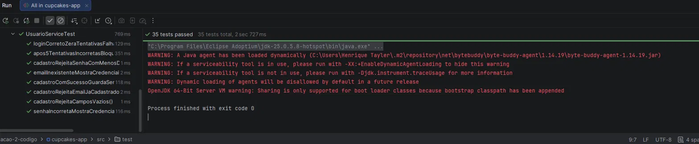

# Laudo de Qualidade — Cupcakes Gourmet

Desenvolvedor: Henrique Tayler Silva · RGM 33296961 · Versão avaliada: 1.1

## 1. Como a qualidade foi verificada
1. **Testes automatizados** (JUnit 5 + Mockito): `mvn test` cobre cadastro, login e bloqueio, carrinho, frete, finalização de pedido, cupom e status do pedido.
2. **Revisão interna do desenvolvedor:** comparação do sistema com as 15 histórias de usuário do PIT I (seção 2).
3. **Testes com 5 usuários** seguindo o `roteiro-para-testadores.md` (seção 3).

Classificação de gravidade: **Alta** (impede comprar ou administrar), **Média** (atrapalha, mas tem contorno), **Baixa** (visual ou melhoria).

## 2. Revisão interna (desenvolvedor)

| Código | Problema encontrado | Gravidade | Situação | Correção / justificativa |
|---|---|---|---|---|
| INT-01 | HU-11 (cupom de desconto) não estava implementada | Média | ✅ Corrigido | Criados `Cupom`, `CupomService`, campo no carrinho, desconto no pedido, script `02_cupom.sql` e 10 testes novos |
| INT-02 | README dizia senha do banco vazia e não citava a porta 3307 | Baixa | ✅ Corrigido | README alinhado com o `application.properties` |
| INT-03 | Endereço do banco e porta fixos no código, impedindo publicar | Alta | ✅ Corrigido | Variáveis `DB_URL` e `PORT` + `Dockerfile` |
| INT-04 | Mensagem de bloqueio sempre dizia "15 minutos", mesmo faltando menos | Baixa | ✅ Corrigido | Agora mostra o tempo que realmente falta |
| INT-05 | Carrinho recarrega a página a cada ação (HU-06/07 RNF#1 pede sem recarregar) | Baixa | ⏳ Não corrigido | Telas renderizadas no servidor (Thymeleaf). A troca por JavaScript fica para uma próxima versão; a funcionalidade em si funciona |
| INT-06 | Sistema não envia e-mails (HU-01 CA#1, HU-09 CA#1, HU-10 RNF#1, HU-14 CA#2) | Média | ⏳ Não corrigido | Exige servidor SMTP pago ou conta configurada; o status fica visível em "Meus pedidos" |
| INT-07 | HU-15 (recuperar senha) não implementada | Média | ⏳ Não corrigido | Depende do envio de e-mail (INT-06) |
| INT-08 | Pagamento simulado; não existe "pagamento recusado" (HU-09 CA#2) | Média | ⏳ Não corrigido | Integração com operadora exige conta e contrato; fora do escopo acadêmico |
| INT-09 | Foto do produto só por URL, sem upload JPG/PNG (HU-12 RNF#1) | Baixa | ⏳ Não corrigido | Hospedagem gratuita apaga arquivos enviados a cada reinício |
| INT-10 | Detalhe sem avaliações e informação nutricional (HU-05 CA#1) | Baixa | ⏳ Não corrigido | Sai do escopo mínimo; alergênicos (RN#1) atendidos |

## 3. Resultado dos testes com usuários

Os 5 testadores usaram a versão 1.0, antes do cupom ser implementado. Formulários completos em `formularios-preenchidos/`.

| Testador | Data | Funcionou | Não funcionou | Não testado |
|---|---|---|---|---|
| João Pedro da Silva | 16/11/2026 | Cadastro, login, vitrine, filtro, adicionar ao carrinho | Nenhum problema | Recuperação de senha, cupom |
| Maria Eduarda Oliveira | 16/11/2026 | Editar/remover do carrinho, frete, finalizar pedido | Sem plataforma real de pagamento | E-mail de confirmação, recuperação de senha |
| Gabriel Henrique Santos | 16/11/2026 | Gerenciar produtos, catálogo, estoque e pedidos | Imagem só por URL | Cupom, recuperação de senha |
| Ana Clara Rodrigues | 16/11/2026 | Detalhes, alergênicos, estoque, acompanhar pedidos | Sem avaliações e info. nutricional | Avaliações, info. nutricional, recuperação de senha |
| Lucas Gabriel Ferreira | 16/11/2026 | Login, bloqueio, compra, baixa de estoque, pedidos (admin) | Sem gateway de pagamento e sem e-mails | Cupom, recuperação de senha |

### Apontamentos e tratamento

| Código | Relato | Gravidade | Situação |
|---|---|---|---|
| T1 | Nenhum problema; cupom não testado | — | Cupom implementado após os testes (INT-01) |
| T2-1 | Sem plataforma real de pagamento | Média | Não corrigido (INT-08) |
| T3-1 | Imagem só por URL | Baixa | Não corrigido (INT-09) |
| T4-1 | Sem avaliações e informações nutricionais | Baixa | Não corrigido (INT-10) |
| T5-1 | Sem gateway de pagamento | Média | Não corrigido (igual a T2-1) |
| T5-2 | Sem e-mails automáticos | Média | Não corrigido (INT-06) |
| Não testado | Recuperação de senha (todos) | Média | Pendente (INT-07) |

Nenhum erro de funcionamento foi relatado nas funções implementadas. Justificativas dos não corrigidos: seção 2.

## 4. Testes automatizados após as correções
35 testes executados, 35 aprovados, 0 falhas.

## 5. Conclusão
Os 5 testes não encontraram falhas nas funções implementadas. Os pontos levantados foram funcionalidades ainda incompletas (pagamento real, e-mails, upload de imagem, avaliações e recuperação de senha). Após os testes foi implementado o cupom de desconto (HU-11); os demais itens ficaram registrados com justificativa para uma próxima versão.
